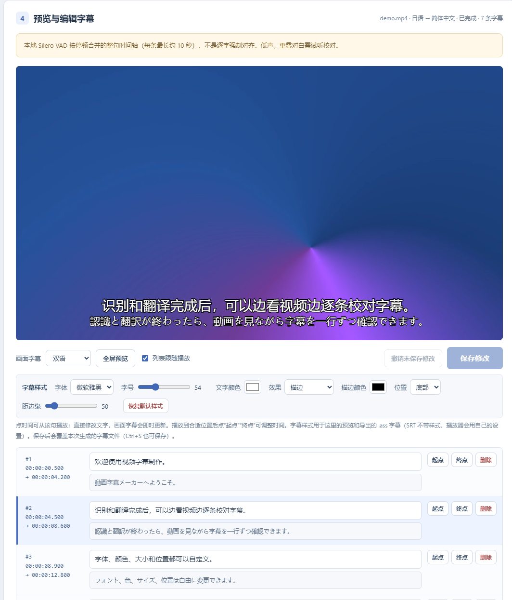

<div align="center">

# 视频字幕制作

**本机视频字幕工作台** · 本地提取音频 · Qwen3-ASR 语音识别（云端或本地 GPU）· DeepSeek 上下文翻译 · SRT / 带样式 ASS

[](LICENSE)


</div>



> 第 4 步：边看视频边校对字幕，画面上的字幕样式和导出的 `.ass` 一致（截图用的是合成的演示视频）。

---

## 特点

**视频不出本机。** 在本地用 FFmpeg 提取音频，用 Silero VAD 按停顿切成整句。选择云端识别时只上传语音片段，翻译时只发送字幕文本。

**识别准，翻译懂上下文。** 语音识别用 Qwen3-ASR-1.7B，可选硅基流动或 DeepInfra 云端，也可以在本地 NVIDIA 显卡上免费运行。翻译用 DeepSeek，每批 20 句并附带前后文，会结合读音纠正同音误识别。

**生成后还能改。** 内置字幕编辑器，视频画面实时叠加字幕，可以逐条改字、调时间。字体、颜色、大小和位置可以自定义，并导出同样样式的 ASS 字幕。

**不重复花钱。** 识别和翻译成功的结果按片段缓存，重跑同一个视频不会重复计费；付费请求失败后不会自动重试。

## 功能

### 识别与翻译
- 语音识别：硅基流动 Qwen3-ASR-1.7B、DeepInfra Qwen3-ASR-1.7B、本地 GPU Qwen3-ASR-1.7B / 0.6B
- 视频语言：日语、中文、英语、韩语等，也可以自动识别
- 翻译：DeepSeek-V4-Pro / V4.1-Flash（硅基流动或 DeepInfra），支持 15 种目标语言，也可以只要原文
- 可填写“内容背景”，帮助模型理解人物和俚语
- 自动过滤识别成其他语言的乱码；日语可以跳过纯语气声（如喘息）
- 显示进度条和实时统计，可随时取消（已经发出的请求仍可能计费）

### 输出文件
保存到视频所在的文件夹。同名文件已存在时自动加上时间戳，不会覆盖：

| 文件 | 内容 |
| --- | --- |
| `视频名.zh-CN.srt` | 目标语言字幕 |
| `视频名.source.srt` | 原文字幕 |
| `视频名.zh-CN.bilingual.srt` | 双语字幕（译文在上，原文在下） |
| `视频名.zh-CN.ass` | 带样式的目标语言字幕 |
| `视频名.zh-CN.bilingual.ass` | 带样式的双语字幕 |
| `视频名.subtitles.json` | 完整结果（时间轴、原文、译文、统计） |

### 字幕编辑器
- 在视频画面上实时叠加字幕：目标语言、双语或原文
- 点时间从该句开始播放，改字后画面立即更新；“起点”“终点”把时间设为当前播放位置
- 可以删除字幕，会检查时间重叠和空字幕；支持 Ctrl+S 保存、撤销未保存的修改、恢复为生成版本
- 全屏预览（也可以双击画面）

### 字幕样式
- 字体（微软雅黑、等线、黑体、楷体、宋体、仿宋）、字号、文字颜色
- 描边、半透明底框或无效果，可设置描边或底框的颜色
- 位置可选底部或顶部，并调整距边缘的距离
- 预览和导出的 ASS 用同一套尺寸换算（按 1080p 像素），已用 libass 渲染核对

> SRT 本身不带样式，播放器会用自己的设置显示。要保留样式，请加载 `.ass` 文件（PotPlayer、mpv、VLC 等都支持）。

## 运行环境

- Windows 10 / 11，并安装 Microsoft Edge（用来打开独立窗口）
- Python 3.13（开发和测试使用的版本）
- 云端识别和翻译需要 [硅基流动](https://cloud.siliconflow.cn) 或 [DeepInfra](https://deepinfra.com) 的 API Key
- 本地识别（可选）需要 NVIDIA 显卡：1.7B 约需 6 GB 空闲显存，0.6B 约需 3 GB；显卡驱动需要支持 CUDA 13

## 安装与启动

```bat
git clone https://github.com/yanzaocheng/video-subtitle-maker.git
cd video-subtitle-maker
python -m venv .venv
.venv\Scripts\pip install -r requirements.txt
```

双击 `Start-ASR.cmd` 启动。程序会在 `127.0.0.1:8765` 启动本机服务，并用 Edge 打开独立窗口。可以给 `Start-ASR.cmd` 创建一个桌面快捷方式。

第一次使用时，在界面底部的“API Key 设置”里保存 Key。Key 存在 Windows 凭据管理器中，不会写进文件、网页或日志。如果只用本地 GPU 识别并选择“原文（不翻译）”，就不需要 Key。

## 本地 GPU 识别（可选）

先安装 [uv](https://docs.astral.sh/uv/)，然后运行：

```bat
.venv\Scripts\python setup_local_gpu.py
```

脚本会在程序目录下创建独立的 `gpu-env`（PyTorch 2.11 + CUDA 13.0，约 1.9 GB），并从 Hugging Face 下载 Qwen3-ASR-1.7B 和 0.6B 模型（分别约 4.1 GB 和 1.6 GB）。所有文件都会校验哈希。只安装其中一个模型：

```bat
.venv\Scripts\python setup_local_gpu.py env Qwen3-ASR-1.7B-hf
```

本地识别在单独的子进程中运行，任务结束后子进程退出并释放显存；显存不足时会自动减小批量。实测在 RTX 3070 上，2 小时 50 分钟的视频用本地 1.7B 识别、V4.1-Flash 翻译，约 4.6 分钟完成。

## 使用流程

1. **选择视频**：直接读取本机文件，不上传也不复制。
2. **识别与翻译设置**：选择识别方式、视频语言、目标语言和翻译模型。
3. **生成字幕**：界面显示费用估算和进度，完成后自动保存到视频所在的文件夹。
4. **预览与编辑字幕**：边看视频边改字、调时间和样式，保存后覆盖本次生成的字幕文件。

时间轴来自本地语音检测，按停顿合并成整句（每条最长约 10 秒），不是逐字对齐，使用前请核对。

## 隐私与费用

- 服务只监听 `127.0.0.1`，并校验页面令牌和请求来源，其他设备无法访问。
- 视频不会上传。云端识别只发送语音片段，翻译只发送字幕文本，都按服务商价格计费；界面会按时长估算识别费用。
- 本地 GPU 识别不产生识别费用，音频也不离开本机。
- 识别和翻译结果缓存在 `cache/`，历史任务保存在 `history/`，字幕样式保存在 `settings.json`；日志和 Edge 配置在 `%LOCALAPPDATA%\ASR-Web`。

## 项目结构

| 路径 | 说明 |
| --- | --- |
| `app.py` | 本机 Flask 服务和接口 |
| `subtitles.py` | 处理流程、批量翻译、SRT / ASS 生成 |
| `media.py` | 读取媒体、FFmpeg 提取音频、Silero VAD 分句 |
| `providers.py` | 硅基流动 / DeepInfra 接口 |
| `local_asr.py`、`local_asr_worker.py` | 本地 GPU 识别子进程 |
| `setup_local_gpu.py` | 一次性安装本地 GPU 环境和模型 |
| `launch.pyw`、`Start-ASR.cmd` | 启动服务并打开 Edge 窗口 |
| `templates/`、`static/` | 界面 |
| `assets/` | Silero VAD 模型 |
| `test_app.py`、`test_subtitles.py` | 测试 |

## 测试

```bat
.venv\Scripts\python -m unittest discover -p "test_*.py"
```

## 致谢

- [Qwen3-ASR](https://huggingface.co/Qwen/Qwen3-ASR-1.7B)（Apache-2.0）
- [Silero VAD](https://github.com/snakers4/silero-vad)（MIT）：`assets/silero_vad_16k.onnx` 的许可证见 `assets/silero-LICENSE.txt`
- [DeepSeek](https://www.deepseek.com)，通过硅基流动或 DeepInfra 调用
- [FFmpeg](https://ffmpeg.org)（通过 imageio-ffmpeg）、[PyAV](https://github.com/PyAV-Org/PyAV)、[ONNX Runtime](https://onnxruntime.ai)、[Flask](https://flask.palletsprojects.com)

## 许可证

[MIT](LICENSE)
