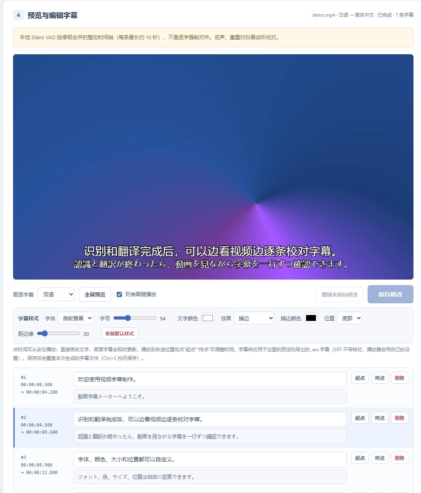

<div align="center">

# 视频字幕制作

**本机视频字幕工作台** · 本地提取音频 · Qwen3-ASR 语音识别（云端或本地 GPU）· DeepSeek 上下文翻译 · SRT / 带样式 ASS

[](LICENSE)


</div>



> 第 4 步：边看视频边校对字幕，画面上的字幕样式和导出的 `.ass` 一致（截图用的是合成的演示视频）。

---

## 特点

**视频不出本机。** 在本地用 FFmpeg 提取音频，用 FireRedVAD 和 Silero VAD 找出说话的地方、按停顿切成整句。选择云端识别时只上传语音片段，翻译时只发送字幕文本。

**识别准，翻译懂上下文。** 语音识别用 Qwen3-ASR-1.7B，可选硅基流动或 DeepInfra 云端，也可以在本地 NVIDIA 显卡上免费运行。翻译用 DeepSeek，每批 20 句并附带前后文，会结合读音纠正同音误识别。

**生成后还能改。** 内置字幕编辑器，视频画面实时叠加字幕，可以逐条改字、调时间。字体、颜色、大小和位置可以自定义，并导出同样样式的 ASS 字幕。

**不重复花钱。** 识别和翻译成功的结果按片段缓存，重跑同一个视频不会重复计费；网络出错、余额不足这类失败不会自动重试。

**个别句子被拒绝不会拖垮整部片。** 翻译服务因内容审核拒绝某一批，或返回格式不对的结果时，程序把这一批拆小重新发送，找出真正过不去的句子：这些句子保留原文并在编辑器里标出，其余字幕照常生成。

## 功能

### 识别与翻译
- 语音识别：硅基流动 Qwen3-ASR-1.7B、DeepInfra Qwen3-ASR-1.7B、本地 GPU Qwen3-ASR-1.7B / 0.6B
- 视频语言：日语、中文、英语、韩语等，也可以自动识别
- 翻译：DeepSeek-V4-Pro / V4.1-Flash（硅基流动或 DeepInfra），或者自己填写任何兼容 OpenAI 接口的服务（见下文“自定义翻译 API”）；支持 15 种目标语言，也可以只要原文
- 记住上一次任务用的识别方式、语言和翻译模型，下次打开不用重选
- 可填写“内容背景”，帮助模型理解人物和俚语
- 自动过滤识别成其他语言的乱码；日语可以跳过纯语气声（如喘息）
- 显示进度条和实时统计，可随时取消（已经发出的请求仍可能计费）

### 输出文件
保存到视频所在的文件夹。同名文件已存在时自动加上时间戳，不会覆盖：

| 文件 | 内容 |
| --- | --- |
| `视频名.zh-CN.srt` | 目标语言字幕 |
| `视频名.source.srt` | 原文字幕 |
| `视频名.zh-CN.bilingual.srt` | 双语字幕（译文在上，原文在下） |
| `视频名.zh-CN.ass` | 带样式的目标语言字幕 |
| `视频名.zh-CN.bilingual.ass` | 带样式的双语字幕 |
| `视频名.subtitles.json` | 完整结果（时间轴、原文、译文、统计） |

### 字幕编辑器
- 在视频画面上实时叠加字幕：目标语言、双语或原文
- 点时间从该句开始播放，改字后画面立即更新；“起点”“终点”把时间设为当前播放位置
- 可以删除字幕，会检查时间重叠和空字幕；支持 Ctrl+S 保存、撤销未保存的修改、恢复为生成版本
- 没有翻译成功的句子（译文和原文相同）会高亮，工具栏的“未翻译 N 句”按钮可以逐句跳过去手动补上
- 全屏预览（也可以双击画面）

### 字幕样式
- 字体（微软雅黑、等线、黑体、楷体、宋体、仿宋）、字号、文字颜色
- 描边、半透明底框或无效果，可设置描边或底框的颜色
- 位置可选底部或顶部，并调整距边缘的距离
- 预览和导出的 ASS 用同一套尺寸换算（按 1080p 像素），已用 libass 渲染核对

> SRT 本身不带样式，播放器会用自己的设置显示。要保留样式，请加载 `.ass` 文件（PotPlayer、mpv、VLC 等都支持）。

### 去马赛克（可选）
- 调用开源的 [Lada](https://github.com/ladaapp/lada)，在本机显卡上检测马赛克区域并用 AI 重新绘制。这是按训练数据补画，不是还原原始画面：多数场景比较自然，部分场景会有伪影；打码的人脸会被跳过
- 可以从预览的当前位置**试处理 60 秒**，满意后再**处理整个视频**；显示进度、速度和预计剩余时间，可随时取消
- 原视频不改动，结果另存为 `视频名.restored.mp4`（H.265，NVIDIA 硬件编码），原音轨直接复制
- 已生成的字幕会复制一份 `视频名.restored.zh-CN.ass` 等文件，播放器打开去码视频时会自动加载；之后在编辑器里保存修改，这些副本也会一起更新
- 去马赛克和本地 GPU 识别不会同时占用显卡，后开始的一个会排队等待；云端识别不受影响

## 运行环境

- Windows 10 / 11，并安装 Microsoft Edge（用来打开独立窗口）
- Python 3.13（开发和测试使用的版本）
- 云端识别和翻译需要 [硅基流动](https://cloud.siliconflow.cn) 或 [DeepInfra](https://deepinfra.com) 的 API Key；翻译也可以改用自己的 OpenAI 兼容接口
- 本地识别（可选）需要 NVIDIA 显卡：1.7B 约需 6 GB 空闲显存，0.6B 约需 3 GB；显卡驱动需要支持 CUDA 13
- 去马赛克（可选）需要 NVIDIA RTX 20 系或更新的显卡（4～6 GB 显存）和 [7-Zip](https://7-zip.org/)

## 安装与启动

```bat
git clone https://github.com/yanzaocheng/video-subtitle-maker.git
cd video-subtitle-maker
python -m venv .venv
.venv\Scripts\pip install -r requirements.txt
```

双击 `Start-ASR.cmd` 启动。程序会在 `127.0.0.1:8765` 启动本机服务，并用 Edge 打开独立窗口。可以给 `Start-ASR.cmd` 创建一个桌面快捷方式。

第一次使用时，在界面底部的“API Key 设置”里保存 Key。Key 存在 Windows 凭据管理器中，不会写进文件、网页或日志。如果只用本地 GPU 识别并选择“原文（不翻译）”，或者翻译用自定义 API，就不需要这两家的 Key。

## 本地 GPU 识别（可选）

先安装 [uv](https://docs.astral.sh/uv/)，然后运行：

```bat
.venv\Scripts\python setup_local_gpu.py
```

脚本会在程序目录下创建独立的 `gpu-env`（PyTorch 2.11 + CUDA 13.0，约 1.9 GB），并从 Hugging Face 下载 Qwen3-ASR-1.7B 和 0.6B 模型（分别约 4.1 GB 和 1.6 GB）。所有文件都会校验哈希。只安装其中一个模型：

```bat
.venv\Scripts\python setup_local_gpu.py env Qwen3-ASR-1.7B-hf
```

本地识别在单独的子进程中运行，任务结束后子进程退出并释放显存；显存不足时会自动减小批量。模型在提取音频、检测语音的同时加载到显卡。

### 语音检测

先找出哪里有人说话，只把这些片段送去识别。用了两个模型，都在 CPU 上运行，不需要本地 GPU 环境：

1. **Silero VAD 整段连续听一遍。** 1 小时以上的音频分成几段并行，每段先重放它前面的 10 分钟（模型需要这么长的前文，实测分句结果和整段顺序检测相同）。
2. **Silero VAD 分成 10 秒的小窗口再听一遍，每个窗口都从空白状态开始。** Silero 的内部状态会记住前面几分钟听到的声音：听过清晰的对白之后，接下来较轻的、被水声或音乐盖住的对白会被它当成“不是语音”，整句整句地漏掉。小窗口没有这段记忆。
3. **[FireRedVAD](https://github.com/FireRedTeam/FireRedVAD) 再听一遍。** 它听得比 Silero 更全，句子按它听到的地方切分。

Silero 两遍都没听到、只有 FireRedVAD 听到的句子可信度较低（很多是呻吟或噪声），所以识别结果如果只有“うん”“はい”这类语气词就会被丢弃，有实际内容的才保留；界面的统计里显示“复查找回 N 句”。这些句子所在的地方噪声大，识别容易出错，建议试听校对。

**怎么量的。** 用一部硬字幕视频（画面上压着字幕组的中文字幕）做参照：用 OCR 读出 1215 句中文字幕和时间，再让语言模型逐句判断同一时刻识别出的日文是否包含这句的意思。参照是意译，判断偏严，所以数字只适合比较方案：

| 方案 | 意思对上 | 部分对上 | 不对 | 没有字幕 |
| --- | --- | --- | --- | --- |
| Silero 听两遍 | 26.7% | 19.4% | 32.4% | 21.4% |
| 加上 FireRedVAD（现在的做法） | 31.0% | 21.2% | 37.7% | 10.0% |

只用 Silero 一遍时，有字幕的参照句只占 55%。多找回来的主要是大声喊叫、低声和噪声里的短句，其中不少会认错，所以“不对”也升高了。同一批片段换成日语微调的 Qwen3-ASR（jaykwok/Qwen3-ASR-1.7B-JA-Anime-Galgame）识别，逐句比较更好 149 句、更差 140 句，没有实际提升，所以没有换。

**代价。** 送去识别的音频更多：这部 2 小时 5 分钟的视频从 53 分钟（866 句）增加到 88 分钟（1074 句），云端识别的费用也相应增加。在 RTX 3070（12 线程 CPU）上，提取音频 4 秒，检测语音 60 秒，本地 1.7B 识别 1074 句约 15 分钟（没有缓存时），翻译另计。

## 自定义翻译 API（可选）

在第 2 步的“翻译模型”里选择 **自定义 API**，填写后保存：

| 项目 | 说明 |
| --- | --- |
| 接口地址 | 一般以 `/v1` 结尾，程序按接口格式在后面加上路径；也可以直接填完整地址。只填域名时自动补 `/v1`。表单下方会显示实际请求的地址 |
| 接口格式 | 见下表；不确定就用 Chat Completions |
| 模型名称 | 服务商给的模型 ID，例如 `deepseek-chat`、`gpt-6.1-sol`、`qwen2.5:14b` |
| API Key | 本机模型（Ollama、LM Studio）可以留空 |

| 接口格式 | 路径 | 适用 |
| --- | --- | --- |
| Chat Completions | `/chat/completions` | 绝大多数服务和本机模型 |
| Responses | `/responses` | OpenAI GPT 系列；有的中转站只在这里提供 GPT |
| Anthropic Messages | `/messages` | Claude 系列；Key 用 `x-api-key` 发送，服务器回 401 时改用 `Authorization: Bearer` 再试一次 |

例如 DeepSeek 官方 `https://api.deepseek.com/v1`、OpenRouter `https://openrouter.ai/api/v1`、本机 Ollama `http://localhost:11434/v1`。有的中转站按模型分接口（例如 7bit：GPT 只走 Responses，Claude 只走 Messages，DeepSeek / GLM / Kimi 走 Chat Completions），格式选错时服务器的报错会写明，界面会提示该改成哪种格式。

- **测试连接**会发一句日语让模型翻译，一次检查地址、Key、模型名和返回格式；测试用的是表单里当前的内容，不会保存。
- 地址和模型名保存在 `settings.json`，Key 保存在 Windows 凭据管理器（`ASR-Web-Custom`），只会发给你填的这个地址；硅基流动和 DeepInfra 的 Key 不会发给它。把地址换成另一台服务器时，原来保存的 Key 会被清除，需要重新填写。
- 请求只带各格式的标准参数。Chat Completions 带 `temperature` 和 `response_format`，Responses 带 `text.format`（以流式、`store: false` 发送，兼容只接受这种请求的中转站），Messages 带 `temperature`。服务器用 HTTP 400 / 422 拒绝时，去掉这些可选参数再发一次（被拒绝的请求不计费），之后都用精简的请求。模型在答案前输出的 `<think>…</think>`、代码块或客套话会被忽略。流式回答没有传完就断开时不会自动重发，因为可能已经计费。
- 不跟随跳转：接口返回 301 / 307 时会提示改填最终地址，避免 Key 被转发到别处。`http://` 的非本机地址会提示“明文传输”。本机和局域网地址不经过系统代理。
- 费用由你的接口决定，程序无法估算。

## 去马赛克（可选）

```bat
.venv\Scripts\python setup_lada.py
```

脚本从 GitHub Releases 下载 Lada v0.11.0 的 Windows NVIDIA 版（两个分卷共约 2.5 GB，按发布页公布的 SHA256 校验），用 7-Zip 解压到程序目录下的 `lada/`（约 5.6 GB），然后删除压缩包。安装后重新打开客户端，界面上会出现“去马赛克”面板。

处理时先在视频所在的文件夹里建一个临时文件夹 `.demosaic-…`，完成后把结果移出来，再删除临时文件夹；开始前会检查磁盘空间（约为原视频的 2 倍）。实测在 RTX 3070 上，1080p 视频约 20～25 帧/秒，比实时播放慢，2 小时的视频约需 2.5～3 小时；4K 更慢。日志在 `%LOCALAPPDATA%\ASR-Web\logs\demosaic.log`。

Lada 以 AGPL-3.0 发布，本项目只把它当作独立程序（`lada-cli.exe`）调用，不包含也不导入它的代码。

## 使用流程

1. **选择视频**：直接读取本机文件，不上传也不复制。
2. **识别与翻译设置**：选择识别方式、视频语言、目标语言和翻译模型（或填写自定义 API）。
3. **生成字幕**：界面显示费用估算和进度，完成后自动保存到视频所在的文件夹。
4. **预览与编辑字幕**：边看视频边改字、调时间和样式，保存后覆盖本次生成的字幕文件。

时间轴来自本地语音检测，按停顿合并成整句（每条最长约 10 秒），不是逐字对齐，使用前请核对。被水声、音乐盖住的对白只能找回一部分，而且识别容易出错。

## 隐私与费用

- 服务只监听 `127.0.0.1`，并校验页面令牌和请求来源，其他设备无法访问。
- 视频不会上传。云端识别只发送语音片段，翻译只发送字幕文本（发给所选的服务商，或你填写的自定义接口），都按服务商价格计费；界面会按时长估算识别费用。
- 翻译被拒绝或返回无法使用的结果时，程序会把这一批拆小再发：被拒绝的请求一般不计费，返回了内容但格式不对的那次会计费。失败的句子达到 20 句、并且比翻译成功的还多时，会停止并提示更换翻译模型。
- 本地 GPU 识别不产生识别费用，音频也不离开本机。
- 识别和翻译结果缓存在 `cache/`，历史任务保存在 `history/`，字幕样式、上次用的选项和自定义接口的地址保存在 `settings.json`（不含 Key）；日志和 Edge 配置在 `%LOCALAPPDATA%\ASR-Web`。

## 项目结构

| 路径 | 说明 |
| --- | --- |
| `app.py` | 本机 Flask 服务和接口 |
| `subtitles.py` | 处理流程、批量翻译、SRT / ASS 生成 |
| `media.py` | 读取媒体、FFmpeg 提取音频、语音检测和分句 |
| `firered_vad.py` | FireRedVAD 语音检测（NumPy 实现，含 Kaldi 滤波器组特征） |
| `providers.py` | 硅基流动 / DeepInfra 接口，自定义 OpenAI 兼容接口 |
| `local_asr.py`、`local_asr_worker.py` | 本地 GPU 识别子进程 |
| `setup_local_gpu.py` | 一次性安装本地 GPU 环境和模型 |
| `demosaic.py` | 调用 Lada 去马赛克、进度解析、任务管理 |
| `setup_lada.py` | 一次性下载并解压 Lada |
| `launch.pyw`、`Start-ASR.cmd` | 启动服务并打开 Edge 窗口 |
| `templates/`、`static/` | 界面 |
| `assets/` | Silero VAD、FireRedVAD 模型 |
| `test_app.py`、`test_subtitles.py`、`test_demosaic.py` | 测试 |

## 测试

```bat
.venv\Scripts\python -m unittest discover -p "test_*.py"
```

## 致谢

- [Qwen3-ASR](https://huggingface.co/Qwen/Qwen3-ASR-1.7B)（Apache-2.0）
- [Silero VAD](https://github.com/snakers4/silero-vad)（MIT）：`assets/silero_vad_16k.onnx` 的许可证见 `assets/silero-LICENSE.txt`
- [FireRedVAD](https://github.com/FireRedTeam/FireRedVAD)（Apache-2.0，小红书 FireRedTeam）：`assets/fireredvad.npz` 是它发布的 VAD 模型权重和 CMVN 统计量，从 `model.pth.tar` / `cmvn.ark` 转换成 NumPy 数组，数值未改动；推理代码 `firered_vad.py` 是对其 PyTorch 实现的重写。许可证见 `assets/fireredvad-LICENSE.txt`
- [DeepSeek](https://www.deepseek.com)，通过硅基流动或 DeepInfra 调用
- [Lada](https://github.com/ladaapp/lada)（AGPL-3.0）：去马赛克，作为独立程序调用，由 `setup_lada.py` 单独下载
- [FFmpeg](https://ffmpeg.org)（通过 imageio-ffmpeg）、[PyAV](https://github.com/PyAV-Org/PyAV)、[ONNX Runtime](https://onnxruntime.ai)、[Flask](https://flask.palletsprojects.com)

## 许可证

[MIT](LICENSE)
